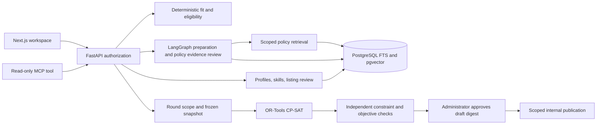

# Architecture

Next.js serves the applicant, organization, placement and administrator screens. Its server-side proxy forwards authenticated requests to the existing FastAPI app. The API verifies roles, session validity, actor ownership and scope. SQLAlchemy maps durable records and Alembic applies PostgreSQL changes. The local SQLite option uses isolated tables and an in-memory checkpointer.

Discovery uses current source-backed listings and accepted profile evidence. It does not consult allocation capacities for ranking. Institution staff attest capacity separately and must be in the declared scope. The API serializes allocation-state changes with a revision row. Drafts retain input and output hashes. Before release, the API compares the frozen inputs with current authority and evidence, then revalidates the draft. Once a draft is published, the same round cannot publish a second draft.

Policy explanations use a single retrieval service. The MCP adapter can call only the policy-only read endpoint with an independent scoped credential. The production database uses PostgreSQL search and vectors. The SQLite local path uses the same evidence filters with a labeled lexical search implementation. It cannot provide durable graph checkpoints or vector retrieval.

The graph saves references, bounded activity, status and evidence IDs. Runtime context supplies the policy question without placing it in the checkpoint. Resume files and their text remain in private storage. File deletion removes active evidence rows and invalidates unpublished drafts whose frozen inputs changed.
