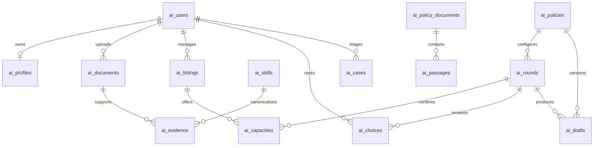

# PostgreSQL schema and migrations

Application tables use an `ai_` prefix. The old SQLite database is not read or migrated automatically. Alembic runs before API startup. pgvector is enabled in migration 001; a GIN index covers `to_tsvector('english', ai_passages.content)`. Embeddings are 384-dimensional vectors labelled with the exact MiniLM model ID; small-corpus vector retrieval is exact cosine ordering rather than a claimed national-scale ANN benchmark.

| Table | Purpose |
| --- | --- |
| `ai_users`, `ai_sessions` | Roles, salted scrypt password hashes, hashed opaque session tokens and eight-hour expiry |
| `ai_invitations` | Hashed, single-use, 48-hour imported-applicant activation tokens |
| `ai_profiles` | Consented participant preferences, optional academic data and separately declared policy groups |
| `ai_skills` | Canonical IDs, names, exact aliases, categories, source/version, related skills, review state and explicit merges |
| `ai_occupations` | Real ESCO occupational URIs, labels, source version and original source records |
| `ai_listings` | Owner, unique source URL and provenance-rich listing details; no default capacity |
| `ai_documents` | Private document reference/storage key and extracted pages; never copied into graph state |
| `ai_evidence` | Applicant claim, canonical skill, exact excerpt/page/section/context, verification status and reviewer/note |
| `ai_policy_documents`, `ai_passages` | Dated/scoped public reference metadata, section text and model-labelled pgvector embeddings |
| `ai_policies` | Immutable allocation configuration, linked explanatory documents and explicit approver |
| `ai_rounds` | Named round tied to one approved policy version |
| `ai_capacities` | Composite round/listing key, explicitly confirmed seats, confirmer and reference |
| `ai_choices` | Composite round/applicant key and ordered top-five listing IDs |
| `ai_cases`, `ai_activity` | Durable agent case references/status and bounded tool-call/outcome timeline |
| `ai_drafts` | Exact result/input snapshot, policy ID, revision, digest, approval binding and publication timestamp |
| `ai_state` | Singleton revision used for serialized snapshot and approval freshness checks |

The LangGraph PostgreSQL saver owns its separate checkpoint tables in the **same PostgreSQL instance/database**. Its `setup()` maintains the library checkpoint schema. It stores case/draft thread state, not raw documents or hidden model reasoning. Deletion calls `delete_thread` to remove private applicant case checkpoints and affected draft-review threads.

Relevant mutations lock the singleton state row and increment the revision. Allocation holds that row lock while producing the snapshot; approval/publication recheck it. PostgreSQL advisory locks serialize invocations of an individual graph thread. This is stronger than the earlier prototype's process-local lock; no separate Redis service is used.

Migrations are forward-only in normal use: initial schema/vector index, source occupational records, evidence-review notes, and invitation activation. Application JSON fields are intentionally straightforward for an academic prototype; it is not claimed to be a national-scale normalized analytics warehouse. Snapshot digest checking and independent verifier logic are in `engine.py`/`main.py`, not inferred from stored policy prose.
